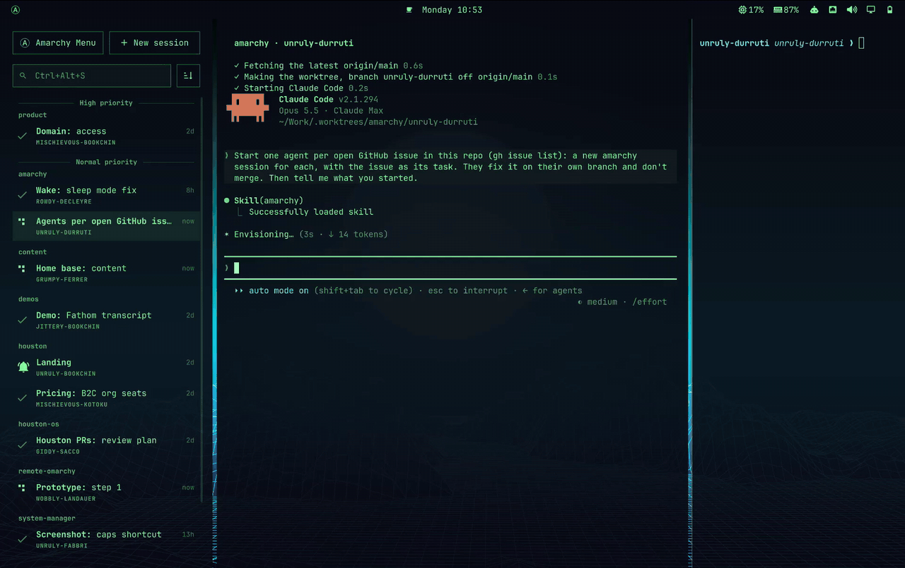

# amarchy

**An agent manager built into your Omarchy desktop.** Run many Claude Code
sessions in parallel, each in its own git worktree, as normal Hyprland windows,
with an Ⓐ in the top bar that lights up when one needs you. For people who live
in [Omarchy](https://omarchy.org) and [Claude Code](https://docs.claude.com/en/docs/claude-code).

<!-- TODO before launch: add a GIF (Super+Alt+N → pick a project → Claude in
the column, the Ⓐ lighting up, Super+arrows between windows) as docs/demo.gif
and put this line here:  -->

- `Super+Alt+N` from anywhere: a new session, on a fresh worktree and branch.
- The **Ⓐ** in the bar lights up when a session needs you; click it for all of them.
- **Amarchy** sits in the Omarchy menu (`Super+Space`), with every action and its key.
- Saved run commands: `Ctrl+Alt+R` runs the project in the terminal beside Claude, `Ctrl+Alt+C` picks another.
- Sessions are ordinary Hyprland windows: `Super+arrows`, `Super+W`, your themes.

## Quick start

You need:

- **Omarchy 4** (tested on 4.0.4): amarchy uses its Lua Hyprland config, the
  Omarchy shell (for the bar and the session list) and the Omarchy menu.
- **[Claude Code](https://docs.claude.com/en/docs/claude-code)**, installed and
  logged in (`claude` on your `PATH`).
- One of foot, kitty, alacritty or ghostty (Omarchy ships one).
- Optional: [`gh`](https://cli.github.com), logged in, to start sessions on
  your GitHub repos from the menu.

```sh
git clone https://github.com/ja-818/amarchy ~/.local/share/amarchy && ~/.local/share/amarchy/install.sh
```

Then press `Super+Alt+N`. amarchy offers every git repo in `~/Work` (set
`AMARCHY_WORK` to use another folder, see [Configure](#configure)), and **New
project** clones one of yours or starts an empty one. Update with `git pull`
in that folder and `install.sh` again; remove with `install.sh --uninstall`.

## Why not herdr, or tmux?

I'm a big [herdr](https://herdr.dev) fan, and if you live in one terminal it's
the thing to use. But on Omarchy the window manager already is a multiplexer:
workspaces, tiling, `Super+arrows`, a bar, a menu, themes. Running a
multiplexer inside it felt like one too many. So amarchy puts the agent
manager in the desktop itself: each session is a Hyprland workspace with
normal windows, the bar tells you who needs you, and the keys, menu and look
are Omarchy's. Same idea, a different home for it.

## How it works

Every session is its own git worktree and branch off the latest `main`, on its
own Hyprland workspace: Claude Code in a centered column, your sessions in the
gap to its left and the session's terminal (it opens in the worktree) in the
gap to its right:

```
 [Ⓐ Amarchy] [󰐕 New session] │                     │
 [󰍉 Search sessions] [󰉋] [󰉹] │                     │ $ npm run dev
                             │                     │
 󰂞  Login: redirect loop   4m│       claude        │
    my-app · wobbly-bakunin  │    (column, 900)    │
 ⠋  Billing: CSV export  12m │                     │
    my-app · smug-goldman    │                     │
 󰄬  README: tidy up       1h │                     │
    docs · sleepy-kropotkin  │                     │
```

Each row says what the session is about in a few words, keyword first, so you
find the one you want by the word in bold: Claude Code's title for the
conversation ("Fix login redirect loop after OAuth callback") cut down by
Haiku to **Login:** redirect loop. It happens once per title, in the
background, through your own `claude` login; until it's done, and with
`AMARCHY_SHORT_NAMES=off`, Claude's title shows as it is. A name you give the
session yourself (`Ctrl+Alt+E`) always wins, and the search still finds a
session by any word of Claude's whole title.

The list is drawn by the Omarchy shell (a shell plugin) with the same type,
rows and selection as the Omarchy menu, in the order you opened them, so a
session keeps its place. Click one to jump to it.

Above it there is only what you reach for: **Ⓐ Amarchy** (the menu: everything
else amarchy does, each with its key), **New session** and a **search**, which
reads `Ctrl+Alt+S`: the key that does the same as clicking it. Type a few
letters of a session's name (what it's about, its project or its branch): the
list narrows as you type, `↑`/`↓` move, `↵` jumps there, `Esc` brings the whole
list back. On a session that's the list beside Claude (moving the pointer onto
Claude or the terminal hands them the keyboard back, as after a click); in zen
mode and outside amarchy, the list under the Ⓐ.

**Zen mode** (`Ctrl+Alt+Z`) leaves Claude alone in the column. Claude doesn't
move: the panels beside it just step away, for every session, until you press
it again or ask for the terminal (`Ctrl+Alt+Return`, or running something in
it). Your sessions are still under the **Ⓐ in the bar**, which lights up when
one needs you, and the list drops from it for a moment when you move between
sessions:

```
                                              Ⓐ
              ┌─────────────────────┐   ┌──────────────────────────────┐
              │                     │   │ 󰂞  Fix the login redirect 4m │
              │       claude        │   │    my-app · wobbly-bakunin   │
              │  (zen column, 900)  │   │ ⠋  Billing export        12m │
              │                     │   │    my-app · smug-goldman     │
              │                     │   │ 󰄬  Tidy the README        1h │
              │                     │   │    docs · sleepy-kropotkin   │
              └─────────────────────┘   └──────────────────────────────┘
```

On a monitor too narrow for anything beside the column, amarchy is always in
zen mode, without a terminal.

Start everything at once, then say what matters: every session has a
**priority**, High, Normal (what a new one gets) or Low. `Ctrl+Alt+Up` /
`Ctrl+Alt+Down` raise and lower the one you're in; in the list under the Ⓐ,
`+` / `-` do it to the one under the cursor. The list puts higher priority
first, unless you sort it by date (and `Ctrl+Alt+J/K` walk it in its order). Under a session's
time sits its priority: a flag (󰈻) for high, an arrow down (󰁅) for low, which
is also dimmed. Every one of them
still notifies you. From a script: `amarchy priority high|normal|low|up|down
[--id <id>]`.

Next to the search, the 󰒼 button opens how the list is grouped and sorted.
**Group by** puts sessions in sections: **by project** (󰉋, one section per
project, each row showing just its branch), **by priority** (󰈻, High, Normal,
Low) and **by status** (󰉹, by what they need from you: Needs you, Working,
Idle), or **Not grouped**. Use any of them; together they nest in the order
you turn them on, each one inside the ones already on, and the menu numbers
them (1 outermost) in place of the check. Turn on priority and then project
for High, Normal and Low with each one's projects inside; project and then
priority for the priorities inside each project. Nested, the outermost
sections are set apart by a rule across the list with their name in the
middle. To change the nesting, turn one off and on again: it goes innermost. **Sort by**
orders the sessions inside each section (or the whole list, ungrouped): by
**priority** (the default: higher first, then the order you opened them in),
**newest first** or **oldest first**. Grouped by project and sorted by
priority, each project's sessions show the ones that matter most on top. The
menu stays open to set several; a click off it closes it. In the list under
the Ⓐ, `g` opens it (`j`/`k`, `↵` to switch, `Esc` to close), `p`, `f` and
`s` switch a grouping directly and `o` goes to the next sort; from a script,
`amarchy group project|priority|status|none`, `amarchy group priority project`
(all of them at once, outermost first) and `amarchy sort
priority|newest|oldest`. The choices stick.

## Keys

| Key | |
| --- | --- |
| `Super+Alt+A` | Open amarchy: back to your last session. Starts a new one if there are none. |
| `Super+Alt+N` | New session: pick a project, that's it. Creates a worktree on a fresh branch named after a famous anarchist with a silly adjective (`wobbly-bakunin`, `caffeinated-goldman`), Claude and a terminal. |
| `Ctrl+Alt+J` / `K` | Inside amarchy: the session below / above in the list, wrapping around. |
| `Ctrl+Alt+S` | Search, the same as clicking the search: on a session, the list beside Claude; in zen mode, the list drops from the Ⓐ. Type to find a session by name, `↵` jumps to it, `Esc` leaves the search. Under the Ⓐ, `Esc` goes to the list itself: `j`/`k` and `↵` to jump, `/` to search again, `+` / `-` to raise / lower a session's priority, `g` for the group & sort menu, `p` / `f` / `s` to switch grouping by project / priority / status, `o` for the next sort (priority, newest, oldest), `Esc` to dismiss. |
| `Ctrl+Alt+Z` | Zen mode: Claude alone, without the sessions and the terminal beside it. Again brings them back. |
| `Ctrl+Alt+Return` | Move the keyboard between Claude and the terminal. In zen mode it leaves zen mode, since the terminal lives beside Claude. |
| `Ctrl+Alt+R` | Run the project in that terminal (`bin/dev`, `npm run dev`, `cargo run`... guessed from the repo; it asks when it can't tell). Again restarts it. Change it with `amarchy run --set`. |
| `Ctrl+Alt+C` | The project's other saved commands: pick one to run in that terminal, or save a new one. |
| `Ctrl+Alt+N` / `P` | New session / new project. |
| `Ctrl+Alt+T` | Pick the theme amarchy wears (see [Theme](#theme)). |
| `Ctrl+Alt+Up` / `Down` | Raise / lower this session's priority (High, Normal, Low): higher ones come first in the list. |
| `Ctrl+Alt+E` | Name this session yourself. The name sits in the list (and in zen mode in the strip above Claude), in place of the short one made from Claude's title. |
| `Ctrl+Alt+M` | The amarchy menu, in a card like the Omarchy menu's: New session and New project on top; the rest in **Run** (the project, a command, the terminal), **This session** (rename, priority, sleep, close), **Sessions** (next, previous, zen mode, sleep the idle ones, close one) and **Settings** (theme, sound, keys). A group has a chevron: `→` or `↵` opens it, `←` goes back (never out of amarchy). The selected row shows its key; typing searches all of it. What only makes sense on a session shows only there. The one to remember. |
| `Ctrl+Alt+X` | Close this session. Asks first: it removes the worktree (and says so when uncommitted changes would be lost). |
| `Super+arrows` | Between Claude and the terminal, like any Omarchy windows. |
| `Super+Space` | **Amarchy** is in the Omarchy menu too: the same rows as `Ctrl+Alt+M`. |

The **Ⓐ in the bar** lights up when a session needs you; click it for your
sessions, right click for a new one.

New session opens the Omarchy menu. The project list ends with **New
project** (also `Ctrl+Alt+P`): pick one of your GitHub repos (searchable, most recently pushed
first), paste a git URL, or start an empty project (optionally with a private
GitHub repo), and the session starts right on it.

A new session shows up at once: its row spins in the list, and you land on
its workspace with Claude's window already in the column. That window sets the
session up in front of you (fetching the latest of the base branch, only that
one, and making the worktree), then becomes Claude, and the terminal slides in
beside it. If it can't (say, a bad base branch), it says why there and the
session goes away; without the network it starts from what was fetched last.

Closing a session (`Ctrl+Alt+X`) asks first if it has uncommitted changes,
then takes you straight to the next session in the list, and its row goes.
The rest happens out of sight: its Claude Code exits as if you'd quit it, its
background sessions stop, its windows close, the worktree is removed and the
branch deleted if it was merged. A notification says when it's done (or, if
the worktree changed meanwhile, why it couldn't, and the session is back in
the list).

Windows are disposable, like everywhere else in Omarchy. Close Claude or the
terminal with `Super+W` (or let Claude exit) and the session just goes to sleep
(below): jumping to it reopens what's missing. A session only really ends with
`Ctrl+Alt+X` or `amarchy close`, which also removes the worktree.

## Sleep

Every Claude Code holds a few hundred MB of memory, also while it waits for
you. So a session you're not using **sleeps**: once it has been idle and off
screen for a minute, its Claude exits and lets go of all of it, and everything
else stays exactly as it was. Its workspace, its place in the list (idle, like
before: the list's glyphs keep saying what the session is doing), and its
window: Claude's own last screen stays up, the conversation, the prompt and the
cursor in it. Only a quiet badge in the window's top right corner says it's
asleep, `󰒲 Asleep, its memory freed · type to wake`.

Go there and type as you would: what you type shows in the prompt, where
Claude would show it. Press **Enter** and Claude comes back with your message
already sent (`claude --resume`, the same conversation); its screen takes over
from the old one in a single repaint, about a second later. Anything else
(arrows, Ctrl keys, Shift+Enter, the wheel, a line longer than the box)
brings Claude back at once, with what you typed already in its prompt. The
moment it starts waking, the badge turns to `󰒲 Waking Claude…` until Claude's
screen is back. A scroll wakes it without reaching Claude: the rest of the
scroll is dropped rather than landing in Claude's prompt (where the wheel would
page through your earlier prompts); scroll again once Claude is up. Moving
through your sessions doesn't wake them; only typing (or scrolling) does. A half-written
prompt survives too: before Claude exits, amarchy asks it for its prompt
(Claude's Ctrl+G, "edit in your editor", answered by `bin/amarchy-editor`), and
it's back in the prompt when Claude is.

A window you closed comes back asleep the same way, with the conversation and
a prompt amarchy draws like Claude's, since there's no screen of Claude's left
to keep.

A session never sleeps while something would be lost with its Claude:

- it's working, or it's asking you something (a permission, a question);
- a command Claude started is still running in the background (a dev server,
  a build);
- background agents are still at it (its conversation is still moving, or
  Claude is busy);
- a `/loop` or a scheduled task is due to wake it;
- Remote Control is on;
- you're looking at it.

Claude Code **background sessions** (`/bg`) started from a session show as
`+1 BG` in its row. When the session sleeps, those with nothing left to do are
stopped as well (Claude Code keeps their conversations: `claude attach <id>`
brings one back); close stops them all, since their worktree goes away. Running
ones are left alone.

```sh
amarchy sleep              # this session, now (it says why not, if something would be lost)
amarchy sleep --all        # every session that can, except the one on screen
amarchy sleep --after 5    # minutes before an idle session sleeps on its own (default 1, or off)
amarchy wake [id]          # without typing in it
```

`amarchy list` says which ones sleep (`sleeping`). **Sleep session** and
**Sleep idle sessions** is under Sessions in the amarchy menu (`Ctrl+Alt+M`). The timer is a
systemd user timer that `install.sh` adds (`amarchy-sleep.timer`); it checks
every 30 seconds and runs nothing in between. Windows from before amarchy
could do this can't hand their prompt over: `amarchy sleep --force` sleeps them
anyway (closing the window, which opens again asleep), so anything typed and
not sent there is lost.

You get a notification when a session you're not looking at needs input or
finishes its turn (via Claude Code hooks, nothing to configure). It reads like
the session's row in the list: a bell or a check, what the session is about,
and project · branch under it. Click it to go to that session. It comes with a
chime, the same one either way; pick it in [Sound](#sound). The bell only rings
when Claude is actually blocked on you (a permission, a question): the reminder
Claude Code sends a minute after a turn you haven't answered doesn't count, so
a finished session never chimes twice.

In zen mode, with the list out of the way, a bar as wide as Claude's
column, divided from it by a line, says which session this is: the status glyph (the
bell in the theme's accent) and what it's about. Hover it for project · branch,
click it to rename the session.

## Claude knows it's in amarchy

Each session's Claude starts knowing where it is: which session, worktree and
branch it's on, where the project's main checkout is, and that the terminal on
its right runs the project. amarchy's `SessionStart` hook tells it, and does
so again after a `/clear` or a compaction. The **amarchy skill**
(`skill/SKILL.md`, which `install.sh` links into `~/.claude/skills`) has the
rest, loaded only when the work calls for it:

- what it can do with the CLI: restart the dev server with `amarchy run`, see
  the other sessions;
- what it leaves to you: anything that moves your screen, and closing its own
  session;
- how to merge back into main;
- how to talk to the other sessions: they are Claude Code instances too, so
  Claude can message them with Claude Code's `ListAgents` and `SendMessage`
  (`amarchy list` gives each session's `agent` name for that), and start a new
  session with a task of its own (`amarchy new <project> --prompt "..."`).

Claude and the terminal also carry the session in their environment:
`AMARCHY=1`, `AMARCHY_SESSION` (its id) and the variables run commands get
(below). So scripts can tell too, and from there `amarchy run`, `rename` and
`close` act on that session, even when another one is on screen.

## Theme

amarchy can wear its own Omarchy theme. Step into a session and the bar,
menus, notifications, wallpaper and window borders change with it; step out and
your desktop is back, in the time it takes to switch workspace. Claude and the
session terminal stay in the amarchy theme.

```sh
amarchy theme              # pick one: Ctrl+Alt+T, Settings → Theme in the amarchy menu (Ctrl+Alt+M), or Super+Space → Amarchy → Theme
amarchy theme "Tokyo Night"
amarchy theme system       # back to looking like the rest of the desktop
```

The picker is Omarchy's own theme switcher, previews and all; it just sets
amarchy's theme instead of your desktop's. **System** comes first: no theme of
its own, amarchy follows your desktop.

Any theme from `omarchy theme list` works. Your Omarchy theme is never
switched: amarchy paints over it and paints it back, so nothing is rewritten or
reloaded. Switch your desktop's theme, restart the shell or reload Hyprland
while you're in a session and amarchy puts its own back on. Claude windows that
are already open take the new colors as they are.

If a piece of the desktop ever stays in the wrong theme, every repaint and how
each step of it went (shell, wallpaper, borders) is in
`~/.local/state/amarchy/theme.log`.

## Sound

Pick the chime by ear: **Settings → Sound** in the amarchy menu (`Ctrl+Alt+M`), or
Super+Space → Amarchy → Sound, opens the sounds in the middle of the screen,
like the Omarchy menu. Each
one plays as the cursor lands on it, with the arrows (or `j`/`k`, or the
pointer), cutting off the one before, so you hear them as you go down the
list. `Enter` or a click sets it, `Esc` leaves it as it was. **Off** for none.

```sh
amarchy sound              # the picker
amarchy sound tine         # set one: kalimba (the default), vibraphone, tine, fairy, ocean, elementary
amarchy sound --play fairy # hear one
amarchy sound off
```

Any sound of your own works: put a `.wav`, `.ogg`, `.oga`, `.opus`, `.flac` or
`.mp3` in `~/.config/amarchy/sounds/` and it shows up in the menu under its file
name (**Add your own** at the bottom of the list, or `amarchy sound --add`, opens that folder). One named like one of
amarchy's replaces it. Keep it short: it plays in full with every notification.

`sounds/CREDITS` says where amarchy's come from; `sounds/make.py` makes its own
ones again.

## Install

See [Quick start](#quick-start) for what it needs. `install.sh` is safe to run
again, and keeps a backup of every file of yours it changes
(`<file>.amarchy-bak.<time>`, the last three). It:

- links `bin/amarchy` into `~/.local/bin`;
- adds one `dofile(...) -- amarchy` line to `~/.config/hypr/hyprland.lua` (the
  keys and Claude's column);
- installs the Omarchy shell plugin (the Ⓐ and the session list) and adds
  Amarchy to the Omarchy menu;
- adds an Omarchy theme hook, the amarchy skill for Claude Code
  (`~/.claude/skills/amarchy`) and the sleep timer (`amarchy-sleep.timer`).

Update with `git pull` and `install.sh` again. `install.sh --uninstall` takes
all of that out again; your worktrees and `~/.local/state/amarchy` are left
alone.

## Configure

**Settings → Keys** in the amarchy menu (`Ctrl+Alt+M`, or `amarchy keys`) picks the two
modifiers: **Inside amarchy**, for every key that works in it (`Ctrl+Alt` by
default), and **From anywhere**, for Open and New session (`Super+Alt`); the
one bound now has a ✓. The keys move as soon as you pick: no restart, and
every hint (the search reads its key) follows. A notification says what the
new keys land on, if anything does (Omarchy's keys, yours, amarchy's other
modifier, or apps that use Ctrl+Shift themselves). From a script: `amarchy keys inside "CTRL + SHIFT"`, `amarchy keys
anywhere MOD3`, `amarchy keys --show`, `amarchy keys reset`.

For the keys themselves, set a table before the `dofile(... amarchy.lua)` line
in `~/.config/hypr/hyprland.lua` (a modifier picked in the menu wins over the
one there, until `amarchy keys reset`):

```lua
amarchy = { mod = "SUPER + ALT", open_key = "A", new_key = "N",
            nav_mod = "CTRL + ALT", next_key = "J", prev_key = "K", search_key = "S", zen_key = "Z", terminal_key = "RETURN", run_key = "R", commands_key = "C",
            nav_new_key = "N", project_key = "P", theme_key = "T", rename_key = "E", close_key = "X", menu_key = "M" }
```

Everything else is environment variables (set them in `~/.config/uwsm/env`):

| Variable | Default | |
| --- | --- | --- |
| `AMARCHY_WORK` | `~/Work` | Every git repo directly inside is offered. |
| `AMARCHY_WORKTREES` | `$AMARCHY_WORK/.worktrees` | Worktrees go to `<this>/<repo>/<name>`. |
| `AMARCHY_TERMINAL` | first installed | `foot`, `kitty`, `alacritty` or `ghostty`. |
| `AMARCHY_ZEN_WIDTH` | `900` | Claude column width in logical pixels; the sessions and the terminal share what's left. Run `amarchy layout` after changing it. |
| `AMARCHY_HEADER_HEIGHT` | `30` | Height of the strip above Claude with the session's name in zen mode, `0` for none. Run `amarchy layout` after changing it. |
| `AMARCHY_CLAUDE_ARGS` | `--permission-mode auto` | Extra arguments for `claude`. |
| `AMARCHY_SOUND` | `on` | `off` for notifications without the chime, whatever [Sound](#sound) picked. |
| `AMARCHY_SHORT_NAMES` | `on` | `off` to list sessions by Claude Code's titles as they are, not cut down to "Keyword: a few words". |

How long an idle session waits before it sleeps isn't a variable: `amarchy
sleep --after <minutes>|off`, kept with amarchy's state.

## CLI

Every action in the UI is a command, in the Omarchy spirit: anything you can
do with a key, a script or an AI agent can do too. Commands print results to
stdout (JSON with `--json`) and exit non-zero on failure.

```
amarchy projects [--json]             your projects and their session counts
amarchy projects --github [--json]    your GitHub repos (✓ = already added)
amarchy add <owner/repo|git url>      clone a project (prints its path)
amarchy add --new <name> [--github]   start an empty project (and a private GitHub repo)
amarchy add                           start a new project interactively (New project in the menu)

amarchy new [project] [name]          create a session (menu without a project; name like wobbly-bakunin if omitted); prints its id
amarchy new <project> [name] --prompt <text|->  the same, with the first thing its Claude is asked (- reads stdin)
amarchy list                          sessions as JSON (agent: the name its Claude has for other sessions' SendMessage)
amarchy open                          go to the last session you were in
amarchy next | prev                   go down | up one session in the list (wraps around)
amarchy jump <id>                     go to a session
amarchy close [id] [--force]          close a session (current one if no id)
amarchy close [id] --confirm          the same, asking first in the Omarchy menu
amarchy rename [title]                name the current session (asks in the Omarchy menu if omitted)
amarchy rename --id <id> [title]      the same for another session; --reset goes back to the one made from Claude's title
amarchy zen [on|off]                  toggle zen mode: Claude alone, nothing beside it
amarchy terminal [on|off]             between Claude and the terminal (leaves zen mode)
amarchy run                           run the project in the session's terminal (again: restart it)
amarchy run --show | --set [command]  the project's run command (guessed from the repo until you set one)
amarchy run <name>                    run another saved command of the project, the same way
amarchy run --save <name> [command]   save one; --forget <name> drops it
amarchy run --list                    the project's saved commands
amarchy run --pick                    choose one in the Omarchy menu, or save a new one there
amarchy show                          open the session list under the Ⓐ in the bar
amarchy search                        type to find a session by name, the list beside Claude, or under the Ⓐ
amarchy pick [close]                  choose a session in the Omarchy menu, jump to it (or close it)
amarchy sleep [id] [--force]          put a session to sleep (says why not when something would be lost)
amarchy sleep --all [--force]         every session that can sleep, except the one on screen
amarchy sleep --after [minutes|off]   how long an idle session waits off screen before it sleeps (default 1)
amarchy wake [id]                     wake a session without typing in it
amarchy menu                          everything you can do from here, with its key, in the Omarchy menu
amarchy theme [name|system]              amarchy in its own Omarchy theme (Omarchy's theme switcher without a name; --show prints it)
amarchy sound [name|off]              the notification chime (the picker without a name; --show, --list, --play [name], --add)
amarchy keys [inside|anywhere <mod>]  the modifiers of amarchy's keys (the picker without one; --show, reset)
amarchy priority [high|normal|low|up|down] [--id <id>]  how much a session matters; higher first in the list
amarchy group [project|priority|status] [on|off]  group the list (switches without on|off); one turned on nests
                                      inside the ones already on
amarchy group <grouping> <grouping>...  group by these, nested in this order, e.g. `group priority project`
amarchy group none                    no grouping (the default)
amarchy sort [priority|newest|oldest] how the list is sorted inside its groups (priority, the default:
                                      higher first, then the order you opened them in)
amarchy layout                        resize Claude's column for the current monitor
```

The run command is saved per project and starts in the session's worktree. It
can use `$AMARCHY_PATH` (the worktree), `$AMARCHY_NAME`, `$AMARCHY_BRANCH`,
`$AMARCHY_REPO` and `$AMARCHY_ROOT` (the project's main checkout), so one command
fits every session of the project. amarchy's own, to try a worktree as the
installed copy:

```
amarchy run --set '$AMARCHY_PATH/install.sh && omarchy-restart-shell'
```

A project can have more saved commands next to its run command, each with a
name: `Ctrl+Alt+C` lists them (and saves new ones), `amarchy run <name>` runs
one. amarchy's own, to put the installed copy back on the main checkout once a
change is done:

```
amarchy run --save main '$AMARCHY_ROOT/install.sh && omarchy-restart-shell'
```

Each new worktree is pre-trusted in `~/.claude.json` so Claude starts without
the folder trust prompt, and the entry is removed again on close.

## License

[MIT](LICENSE). The notification sounds in `sounds/` keep their own licenses,
listed in [`sounds/CREDITS`](sounds/CREDITS).
