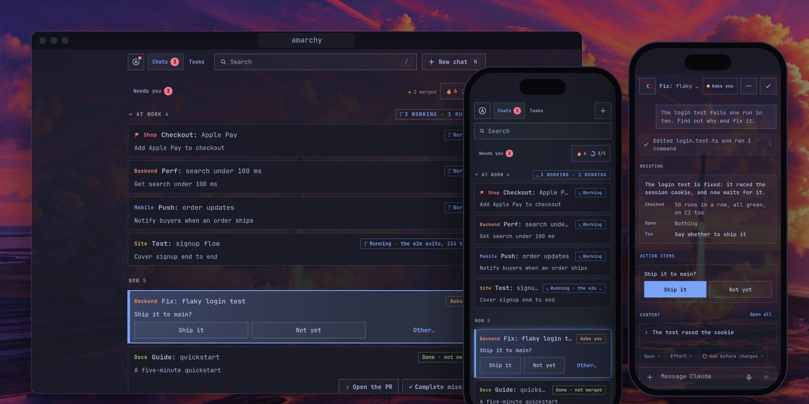

<div align="center">

# Ⓐ amarchy

## Stop babysitting your agents. Manage them.

A dozen Claude Codes on your own box, run from your phone or any browser.
One board says which one needs you and what for. You answer with a tap.



[Install](#install) · [Keys](#the-keys-that-matter) · [Full guide](docs/guide.md)

</div>

## Why

- **One agent, you babysit it.** You watch its terminal, wait on it, read every word. A dozen
  that way is a full-time job.
- **A dozen, you manage them.** The board says who needs you and what for. Every reply opens
  with a briefing. Questions, permissions and "Ship it?" are buttons.
- **They keep working without you.** Each chat has its own git worktree and branch, on a Linux
  box that stays on. Shut the laptop: your phone buzzes when one needs you.

## What you get

- **A board that says who needs you.** **Needs you** filters to the chats waiting on you,
  **At work** has the busy ones, and **Now** and **For later** are in the order you decide. A
  chat's question shows on its card: answer it there, without opening the chat.
- **Briefings, not walls of text.** Every reply opens with what happened, what was checked and
  what's on you. Your choices are buttons; the details stay folded until you want them.
- **Questions and permissions as buttons.** When Claude needs a yes, a choice or a plan
  approved, it shows a card. You tap a button and it carries on.
- **Ship it is a button.** One tap: merged into main and pushed. Streaks and badges count
  every merge.
- **A chat for each piece of work.** Pick a project, type what you want, and Claude starts on it.
  Each chat has its own copy of the project, so ten chats can change ten things at once.
- **Your phone buzzes when it matters.** A chat that needs you or is done notifies you (or a
  chime plays). Tap the notification and you land on the card.
- **Talk instead of typing.** The mic by the box writes what you say into it. A speech model
  on your own machine does the writing, so the audio stays there.
- **Keys and passwords stay out of the chat.** When a project needs one, Claude asks in an
  app card, and the value is kept on your machine, never in the conversation.
- **Light on memory.** A chat you're not using goes to sleep and frees its memory. Send it
  something and it wakes up where it was.
- **Previews that stay up.** What a chat serves for you to look at (a dev server) runs as the
  chat's own service, capped in memory: a sleeping Claude doesn't take it down, its Preview
  button starts it again in one tap, and completing the chat stops it and checks it's gone.
  Two or more (an app and its storybook)? The button is Previews: pick one from its dropdown.
- **Keeps going with the lid shut.** Run amarchy on a machine that stays on. Your chats keep
  working while your laptop or phone sleeps.
- **Every machine's chats on one board.** Your server, your desktop, a laptop: pair them
  (`amarchy machines add <name>`) and every chat from every machine is on the same board, each
  card saying where it runs. Start a new chat on any of them, and move one to another when you
  choose (its branch, its conversation and its place on the board go with it); a machine that's
  off keeps its chats on the board, dimmed, until it's back.
- **A machine that never sleeps, in one tap.** No box at home? **Add a cloud machine** makes
  one in your own Hetzner, DigitalOcean or Hostinger account (their prices on each size; the
  provider bills you, never amarchy), sets it up with Claude Code and amarchy, puts it on your
  tailnet and on your board. Then Sign in to Claude there, from the app.
- **Agents with a job.** A chat that never ends: your inbox, your X account, Monday's report.
  It texts you like a coworker and keeps what needs you on **Tasks**, as boards: comment on a
  card and it revises it, write it a task and it helps you get it done. Approving is yours alone.
- **On your phone, in your browser, and on your desktop.** An app you add to your home
  screen, the same app on a computer, and a desktop app of its own (Linux first, Omarchy at
  home). All of them work over your private Tailscale network, not the internet. The iPhone
  and Android apps add answers right on the notification, the share sheet and a widget,
  end-to-end encrypted through a tiny open-source push relay that can't read them.
- **At home on Omarchy.** The **Ⓐ** in the bar lights up when a chat needs you and says how
  many; click it and you're on that chat. **Super + D** brings amarchy to the front, and
  it's in the Omarchy menu. Pick **Omarchy (live)** and the app wears your desktop's theme,
  wallpaper and font, on every device, changing when the desktop's does.

## Install

You need a Linux machine that stays on (a server, or a PC at home), with
**[Claude Code](https://docs.claude.com/en/docs/claude-code)** installed and logged in, plus
`git`, `tmux` (3.5 or newer) and `python3`. To use it from your phone or a browser you also
need [Tailscale](https://tailscale.com) on your devices, with HTTPS certificates turned on for
your tailnet: `amarchy tailscale` sets it up and opens what's left. A machine without Tailscale
installed gets amarchy's own Tailscale node instead (`amarchy-tailnet login` signs it in).

```sh
git clone https://github.com/ja-818/amarchy ~/.local/share/amarchy && ~/.local/share/amarchy/install.sh
amarchy app on
```

`amarchy app on` prints the address of the app. On your phone, open it in Safari, tap
**Share → Add to Home Screen**, and open amarchy from there. Then add a project: amarchy
offers every git repo in `~/Work`, or clones one of your GitHub repos.

Run `install.sh` again at any time to update. `install.sh --uninstall` removes amarchy and
leaves your projects and chats alone. On a computer with a desktop it also builds the
**desktop app** ([The desktop app](docs/guide.md#the-desktop-app)), and on Omarchy it puts the
Ⓐ in the bar, the key and the menu entry ([On Omarchy](docs/guide.md#on-omarchy)).

## Coming from Omarchy

amarchy was made on [Omarchy](https://omarchy.org), and fits Omarchy 4 the way its own pieces
do. Omarchy's agent tools put one agent in front of you; amarchy runs a dozen of your Claude
Code agents while you're elsewhere, and calls you only where you're needed. Its install finds
Omarchy by itself and adds, without editing any of Omarchy's files:

- **the Ⓐ in the bar**: lights up when a chat needs you, says how many; a click opens it.
- **Super + D** brings amarchy to the front (`amarchy key` picks another), and
  **Amarchy** is in the Omarchy menu.
- **Omarchy (live)**: pick it in Settings → Look, and amarchy wears your desktop's theme,
  wallpaper and font on every device, changing when you switch Omarchy's.
- **Ctrl + Alt + O**: a chat's terminal in a Ghostty window.
- While a chat works, the laptop doesn't doze off (the screen still locks, the lid still
  sleeps it); Tailscale through Omarchy's own (`omarchy-install-service-tailscale`), or
  amarchy's node without it.

Every chat is Claude Code with your own plan: Omarchy's `omarchy-default-agent claude`
installs it. Then amarchy, either way:

```sh
git clone https://github.com/ja-818/amarchy ~/.local/share/amarchy && ~/.local/share/amarchy/install.sh
```

or as Arch packages, `amarchy-git` and `amarchy-desktop-git` (built from
[packaging/arch](packaging/arch/PKGBUILD)):

```sh
git clone https://github.com/ja-818/amarchy && cd amarchy/packaging/arch && makepkg -si && amarchy setup
```

`amarchy setup --uninstall` (or `install.sh --uninstall`) takes every piece away again.
More in the guide: [On Omarchy](docs/guide.md#on-omarchy).

## The app

- **The list**: your chats, each with its name, what it's doing ("Needs your answer",
  "Working", "Done", "Ready") and its project, in **At work** (folded, on top) and two lists you decide: **Now**
  (pinned on top) and **For later**. Only working moves a card; **Needs you** filters to what waits on you.
- **The chat**: what you said, what Claude says, the steps it took (folded into one line you
  can open), and the cards for its questions and permissions. Under it, the box you type in,
  with the model and how Claude asks for permission.
- **Chat | Terminal**: the project's own terminal, where you run it (`npm run dev`, say). On a
  computer it's a panel beside the chat.
- **Settings**: sleep, sounds, notifications, the look, dictation, secrets and the terminals.
- **The tour**: amarchy in 100 seconds, with pixel art. It opens by itself the first time
  you open an empty amarchy on a device; after that it's **Tour** in the Amarchy menu (the **Ⓐ**).

## The keys that matter

On a computer, three rules: **Ctrl+Alt + a key does things**, from anywhere, even
while you type (as Super does on Omarchy); **Esc stops Claude**, as in Claude Code,
and nothing else; every other key only moves, or types.

| Key | |
| --- | --- |
| `Ctrl+Alt+←` / `→` | Back to the board / into the chat lit |
| `Ctrl+Alt+↑` / `↓` | The chat before / after |
| `Ctrl+Alt+↵` | New chat |
| `Ctrl+Alt+Space` | **The amarchy menu: everything else, and any chat by its name** |
| `Ctrl+Alt+W` | Complete the chat's mission (close it, with Undo) |
| `Ctrl+Alt+T` | The chat's terminal (again: back to the chat) |
| `Ctrl+Alt+P` | Open the chat's preview (of several: pick one) |
| `Ctrl+Alt+D` | Dictate into the chat (hold it, or tap it and tap again) |
| `Ctrl+Alt+K` | Every key |
| `Esc` | Stop Claude (on its question: no) |
| `j` / `k`, `Enter` | Card to card, message to message; open it, press it |

A chat opens in its box: `↑` goes up onto its messages, `↓` on the latest back down.

Every action is also a command: `amarchy help`. On Omarchy, **Super + D** brings amarchy to
the front from anywhere (`amarchy key` picks another).

## More

The **[full guide](docs/guide.md)** covers all of it: [how it works](docs/guide.md#how-it-works),
[the chat](docs/guide.md#the-chat), [your phone](docs/guide.md#your-phone),
[the browser](docs/guide.md#in-a-browser-on-your-computer), [the desktop app](docs/guide.md#the-desktop-app),
[dictation](docs/guide.md#dictation), [secrets](docs/guide.md#secrets),
[sleep](docs/guide.md#sleep), [Omarchy](docs/guide.md#on-omarchy), [packages](packaging/README.md), [themes](docs/guide.md#theme), [sounds](docs/guide.md#sound),
[configuration](docs/guide.md#configure) and [the CLI](docs/guide.md#cli).

[MIT](LICENSE)
